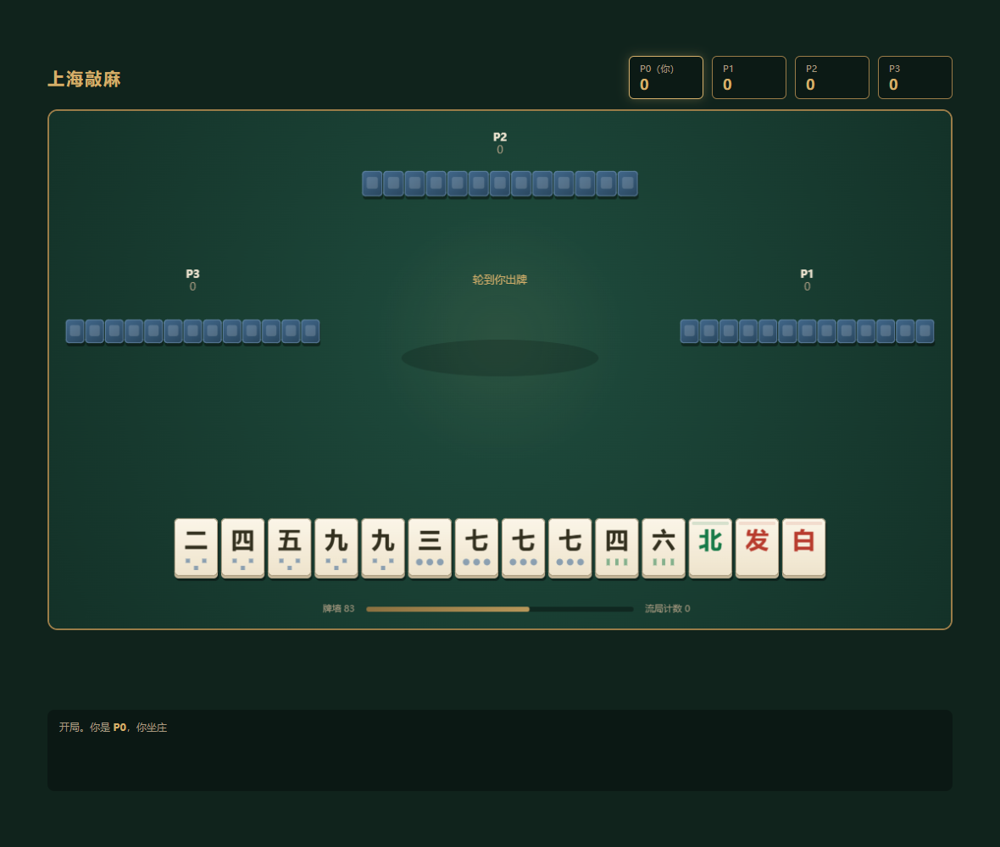

# 上海敲麻

> TypeScript + Canvas 实现的地方麻将游戏，核心规则为**必须先「敲」（报听）才能胡牌**。

敲麻是上海地区流行的麻将变种，与日麻「立直」形似但更严苛——未敲直接胡算诈胡倒赔三家，敲后锁定听口不可更改，有杠必杠、有胡必胡。本项目完整实现了其用牌、补花、敲、吃碰杠、胡牌判定与番数结算，并内置一个启发式 AI 对手，可人机对战，也可无头批量模拟。



## 特性

- **完整规则引擎**：144 张牌（万筒条 + 风牌 + 中发白/季节花作花牌）、自动补花、吃碰杠、敲、胡牌牌型与花数门槛
- **引擎/界面完全解耦**：`core/` 是纯逻辑状态机，零 DOM 依赖，可无头跑 300 局/秒级模拟
- **Canvas 矢量渲染**：牌面以路径绘制，万筒条分色，移动端自适应（横竖屏、安全区、刘海）
- **启发式 AI**：三层策略（牌效 / 危险度 / 敲的时机），AI 敲后自动胡
- **可配置规则**：底花、自摸/点炮门槛、封顶倍数均可通过 `ScoringConfig` 调整
- **种子复现**：`Wall` 支持固定种子，便于回归测试与平衡性调参

## 技术栈

- **TypeScript**（ES2022 + NodeNext，strict 模式）
- **Node.js 原生 http**（静态服务器，无第三方运行时依赖）
- **Canvas 2D**（矢量绘制，无图片资源）
- **node:test**（内置测试框架）

## 快速开始

```bash
npm install            # 安装依赖，postinstall 自动跑 tsc 编译到 dist/
node dist/src/ui/server.js   # 启动，默认 http://localhost:5173
```

换端口：

```bash
# Windows PowerShell
$env:PORT=5180; node dist/src/ui/server.js
# Linux/macOS
PORT=5180 node dist/src/ui/server.js
```

手动重新编译：

```bash
npx tsc               # 编译到 dist/
npx tsc --watch       # 增量编译，开发用
```

## 测试

```bash
npx tsc && node --test dist/test/core.test.js
```

测试覆盖和牌判定、副露张数守恒、字牌只成刻不顺、花数与番数结算等核心规则。

## 玩法要点

- **必须先敲才能胡**：手牌听牌后宣告「敲」，锁定听口不可更改
- **敲后有胡必胡**：漏胡算诈胡，倒赔三家
- **敲后有杠必杠**，可杠可胡时胡优先
- 番数：门清 1、大吊车 1、碰碰胡 1、混一色 1、清一色 2、混碰 2、清碰 3、杠开 1、黄庄 1
- 倍数 = 花数 × 2^(番数总和) × 荒番倍数，自摸再 ×3
- 单局封顶底分 128 倍
- 底花 2 花：自摸需手牌 ≥2 花，点炮需 ≥3 花

完整规则与已实现/待定项见 [敲麻规则-已实现.md](敲麻规则-已实现.md)。

## 项目结构

```
src/
├── core/
│   ├── tiles.ts       牌面模型（0-33 索引）、和牌判定、听牌表（带记忆化缓存）
│   ├── wall.ts        牌墙与洗牌，支持种子复现
│   ├── scoring.ts     花分与番数计算
│   └── game.ts        对局状态机（纯逻辑，无界面依赖，可无头批量模拟）
├── ai/
│   └── ai.ts          牌效启发式 + 危险度评估 + 敲的时机决策
└── ui/
    ├── render.ts      Canvas 渲染（牌面矢量绘制、万筒条分色）
    ├── main.ts        交互控制器
    └── server.ts      静态服务器
test/
└── core.test.ts       规则单元测试
public/
└── index.html         前端入口（Canvas + 操作按钮 + 日志区）
*.mjs                  自动对局/移动端截图等脚本（依赖 playwright-core）
```

## 设计要点

**引擎与界面完全解耦。** `core/` 不含任何 DOM 操作，输入状态 + 动作，输出新状态。这让无头批量模拟成为可能——AI 强度测试、规则回归、平衡性调参都靠它。

**手牌张数守恒。** 副露 `m` 组时，打牌前手牌恒为 `(4-m)×3+2`，打牌后 `(4-m)×3+1`。改引擎时用这个不变式做断言，能立刻发现回合流转的 bug。

**听牌表记忆化。** `winningTiles()` 是最热的路径（每次弃牌、每次判断能否敲都会调用），用牌面计数数组编码成字符串做 key 缓存，实测单次决策 0.014ms。

**AI 的核心是「敲不敲」而不是「打哪张」。** 敲麻里宣告时机比选牌更关键——敲早了锁死烂听口，敲晚了被人看穿。`evaluateQi()` 从听口宽度、剩余张数、牌墙深度、番数潜力四个维度评估。

## 已知不足

- 流局率约 20%，偏高。真实敲麻因「必须敲才能胡」本身流局就多，可进一步优化 AI 的敲牌决策降低比例
- AI 是启发式，不是搜索。中间档位（不弱也不强），要更强的对手需要上蒙特卡洛模拟
- 各地敲麻规则差异较大（花分体系、是否可吃、封顶规则），当前取了一套主流配置，改 `DEFAULT_CONFIG` 或 `ScoringConfig` 可调
- 未实现联机对战

## License

ISC